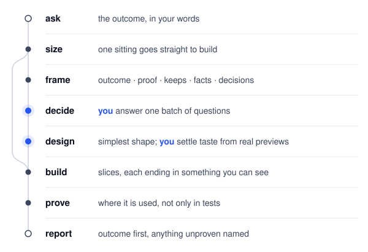

# nstack

How I build software with coding agents: a short set of standing rules, skills that load when the work calls for them, and a few slash commands for [omp](https://github.com/can1357/oh-my-pi).

Coding agents fail in predictable ways on real work. They start building before the facts and decisions that decide the result are pinned down. They build more than was asked, in more parts than the problem needs. They build a look at full scale before anyone has seen it. They patch a fault where it shows instead of fixing it at the root, and the next agent copies the patch. They call it done because the tests pass, not because it works where it will be used. And they keep spending agents, reviews and tests long after more of it stops changing the outcome. nstack aims every step at the end state: the simplest correct design, finished in every state and crafted, proven where it is used. It works when I can hand over a large feature or a whole product once and get back what a company of principal engineers would have designed over years.

It is written for one person, me (Nate), and tuned against an audit of about a thousand of my own agent sessions. The rules name me, my Mac and my phone on purpose: an agent does better with a specific person and a specific setup than with "the user". It is published as a reference. Fork it and make it yours.

## The ideas

Every rule follows from five ideas, and agents reason from them wherever no rule fits:

- **The end state is the work.** A plan, check, review or question earns its place by being likely to change what the person gets.
- **Proportion.** The person's attention, wall time and usage are all costs. Agent time is cheap next to theirs, so agents do the translating: what the person reads or decides from is built for them.
- **Reality settles facts; the person settles taste.** Facts, causes and numbers get checked, not assumed. Taste, scope and one-way doors are decided by the person from real previews.
- **Simple is correct.** The simplest architecture that does what was asked is quick to build, easy to debug and cheap to change, and it extends when a real need shows up. Simple describes the code that results, not the size of the change.
- **A worker knows only its brief.** Delegation carries intent exactly as far as the brief does.

## How a task runs

<picture>
  <source media="(prefers-color-scheme: dark)" srcset="https://raw.githubusercontent.com/nategriffin26/nstack/master/docs/task-flow-dark.svg">
  <source media="(prefers-color-scheme: light)" srcset="https://raw.githubusercontent.com/nategriffin26/nstack/master/docs/task-flow-light.svg">
  
</picture>

Each question comes with a recommended default, and work that does not depend on the answer keeps moving while you think. The frame's facts are checked with a command, never assumed. Done means it works where it is used: the app on your phone or simulator, the installed command, the deployed service, the rendered file, each with real data.

## What's in it

| Piece | Loads | What it does |
|---|---|---|
| `omp-rules.md` | every session and subagent, always | The floor: thirteen standing rules in under 4,000 characters |
| `skills/nstack` | before features, multi-step changes, unsettled fixes, and agent briefs; autoloaded into author agents | The method: firm at **Start** and **Done**, freedom and craft in between, with subagent, ledger, review, and testing detail in `references/execution.md` |
| `skills/nstack-design` | large asks: rewrites, new systems, unsettled architecture or look | Ground the facts, walk real failures on your setup, and write the one-page shape with vertical slices |
| `skills/nstack-review` | reviews and critic verdicts | What could hurt on the real setup and what to cut, tighten, or redesign, as advice; prefers another model family, falls back to a fresh same-family critic |
| `skills/nstack-verify` | when proof needs more than tests, a number decides something, or speed is the goal | Proof on the real surface, audited numbers before decisions, and a profiled speed loop |
| `skills/nstack-writing` | before prose anyone reads beyond a few lines | Plain-English writing rules, working-vs-reporting register split, tiered edit pass, a 28-pattern catalog (`references/catalog.md`), genre/voice guides (`references/genres.md`), and an offline linter (`scripts/prose_lint.py`) |
| `skills/nstack-research` | whenever outside facts are needed | Picks the right depth (Look up, Dig, Wave, or Trail), checks earlier research first, and saves findings |
| `skills/nstack-research-worker` | autoloaded into the `researcher` and `verifier` agents | Field guide for research and verification lanes: searching, reading, dossier/map formats, and confidence rules |
| `skills/nstack-climb` | when work should match or beat chosen exemplars | Rounds judged blind by fresh models from other companies against your exemplars; `scripts/judge.py` runs judges via `omp -p` |
| `skills/nstack-grill` | explicit only (`/nstack grill`, hidden from auto-router) | Short rounds of numbered questions to align before building |
| `skills/nstack-formal` | when asked to formally verify or model-check (`/nstack formal`) | Formal verification of the highest-risk promise in a repo, left as a one-command check |
| `skills/nstack-skills` | before writing, updating, merging, or retiring a skill | When a skill earns its keep, routing-ready descriptions, body bar, and `skill-eval` check |
| `skills/schematic-figure`, `skills/patent-drawing` | drawing a schematic, concept figure, block diagram or patent sheet | [LGW Lab's](https://github.com/lgwrightlab/schematic-figure) vendored skills (MIT, see `skills/schematic-figure/UPSTREAM.md`) |
| `skills/video-brief` | making a short film, app demo or motion piece from a one-line idea | The brief, three directions as stills to pick from, the render on the right renderer per beat, and a fresh critic's review |
| `tools/web.py` | on PATH as `web` | Search, read, GitHub and Reddit readers, a page store and a citation log that `web check` scores; `web mcp` serves it over MCP, and `tools/executor-web` is that server as an Executor app |
| `tools/skill_eval.py` | on PATH as `skill-eval` | Scores real past requests against each store's skill list as its router sees it, current beside proposed; cases stay private in `local/evals/skill-routing/` |
| `extensions/nstack-guard.ts` | always, as an omp extension | One-line notes where written rules did not hold: a message to a critic after its verdict, a question while agents run, a ledger past 12 KB, a comment about earlier code or the conversation, and a pointer back to the ledger after compaction |
| `extensions/brief.ts`, `extensions/brief.md` | when typed, as `/brief` | A briefing agent reads the request and the code, docs and history it touches, then sends the brief as your prompt in the same session |
| `tools/brief_eval.py` | by hand | Measures `/brief` on real past requests, briefed against direct, judged by a model of another family |
| `roster.toml`, `agents/` | at install | Which model does which job; generates omp's agent files and the routing section in `~/.omp/agent/AGENTS.md` |
| `audit/scripts/session_audit.py` | by hand | Reads omp's local session logs and prints what they show per period: sessions that read the nstack skill before, after or never before their first edit, subagents spawned, questions asked, cost, and the follow-up messages a session needed. The other scripts in `audit/scripts/` are the October 2026 audit's studies |

## Commands

| Command | Does |
|---|---|
| `/nstack <task>` | Runs the task under the full method; useful when a session treats a real feature as a quick fix |
| `/nstack shape <ask>` | The one-page shape and one batch of questions; builds nothing |
| `/nstack grill [topic]` | Rounds of numbered questions on the important decisions, each with a recommended answer |
| `/nstack review` | One deep review of the current change (cross-family preferred; fresh same-family fallback) |
| `/nstack verify` | Proves the current work on the real surface and audits any measured number |
| `/nstack formal [area]` | Formally verifies the riskiest promise in the repo or named area; `formal maintain` resyncs an existing check |
| `/nstack correct <mistake>` | Fixes a recurring mistake in structure (type, lint check, or test), proven against a real past instance |
| `/nstack simplify [area]` | Makes an area smaller without changing what it does, one commit per change, with the files touched per commit recorded for the next pass |
| `/brief <request>` | A briefing agent investigates first and writes the prompt: your words quoted, the facts and decisions that bear on them, the questions only you can answer, and what done looks like |

## Asking well

- Give the outcome in your own words, where you will check it, what must not change, and references for anything visual (or "show me directions").
- For a long run, give a finish condition that can pass or fail. A duration is not one.
- For a bug, describe what you see rather than your theory of the cause, so the agent looks everywhere first.
- A fix goes in at the root even when you ask for a quick one. Say "patch it for now" when a patch is what you want.
- Races between models and extra critics run only when you ask for them by name ("race opus and astra on this").
- Anything you say explicitly overrides nstack: models, number of agents, skipping a preview.
- Long work keeps one ledger at `local/nstack/<slug>.md` in the project; "continue <thing>" resumes from it.

## Install

Needs omp and Python 3.12 or newer. Used on macOS.

```sh
gh repo clone nategriffin26/nstack ~/Projects/nstack
cd ~/Projects/nstack
python3 install.py              # back up, install, then run --check
python3 install.py --check      # verify links, generated files, rule blocks, sizes and roster models
python3 install.py --uninstall  # remove nstack and restore what the first install replaced
```

The installer symlinks the skills, commands and extensions into `~/.omp/agent/`, `tools/web.py` to `~/.local/bin/web` and `tools/skill_eval.py` to `~/.local/bin/skill-eval`, generates one agent file per roster agent, and writes marked blocks into `~/.omp/agent/RULES.md` and `~/.omp/agent/AGENTS.md`. The first install backs up everything it touches to `local/backups/baseline/`, and `--uninstall` restores from there; every later install writes a dated backup and removes links to files the repository no longer has. Edit files in the repository, never the installed copies, and rerun the installer.

`web` reads its keys from the environment or `~/.omp/agent/keys.env`: `EXA_API_KEY` for search, `TINYFISH_API_KEYS` (comma-separated free keys) for reading and as the search fallback, optionally `BRAVE_API_KEY`, `SERPER_API_KEY` and `PARALLEL_API_KEY`, and `OPENROUTER_API_KEY` for the support score `web check` gives each claim (without it, check skips the score and says so). `web save` and `web prior` keep research in [nbrain](https://github.com/nategriffin26/nbrain) when its CLI is on PATH.

omp's own agent settings decide which roster agents are on and which model each runs: the installer leaves out of the routing any agent omp has switched off or whose model is not in `omp models`, names a pinned model as omp runs it, and says so when it does. On a different setup, edit `roster.toml` to models you have.

## Make it yours

1. **Fork and clone** it anywhere; the installer links from wherever the repository sits. `git grep -n "Projects/nstack\|Dross Settings"` lists the lines that name my path and my model settings page.
2. **Put your name in.** `git grep -n Nate` finds every mention. Swap my phone, Mac and data for the places you check your own work.
3. **Pick your models.** `roster.toml` maps roles (author, systems, taste, implementer, reader, research, verify) to agents and agents to models from `omp models`; `family` decides which models review each other.
4. **Install and probe.** Run a fresh omp session on an ordinary-looking task in a scratch repo, and judge it by what the agent actually read, ran and changed, not by what it says it followed.

`--check` holds `omp-rules.md` under 4,000 characters and each skill under 20,000: the rules ride on every turn of every session, so the floor stays short and the detail loads on demand.

## Credits

- [pstack](https://github.com/cursor/plugins/tree/main/pstack) by Lauren Tan (MIT, 0.15.36): agent control in `skills/nstack` › Agents (orchestrate, swarm, interrogate), the measurement checks and verify script in `nstack-verify` (benchmark-checklist, explain-the-number, hillclimb, create-verification-skill with its right-build check and run-once rule, and the guide's "match the check to the change"), the rules in › Fixes (bug-fix, attack-the-premise, fix-root-causes), `/nstack correct`, and `nstack-formal` (create- and maintain-formal-verification-skill).
- [Specula](https://github.com/specula-org/Specula) (Apache-2.0): `nstack-formal`'s history-mined targets and trace validation.
- [mattpocock/skills](https://github.com/mattpocock/skills) (MIT): the grilling behind `nstack-grill`, and the deletion test and history-read targets in `/nstack simplify`.
- [helix](https://github.com/DocumentDrivenDX/helix): the no-process-porn skill.
- [Planning with Agents](https://maggieappleton.com/planning-agents) by Maggie Appleton: agents doing the translating, the shape kept for builders while I read a version built for me, options shown by what they do to the real code, live controls for a continuous taste value, and short grill rounds with "show me".
- [U.S. Graphics Company](https://x.com/usgraphics/status/2114413710395720182): the floor's line on language and names, from their specification-register naming rule; a reply's critique kept the register and traded the persona for its rules.
- [0xdef1](https://x.com/0xdef1/status/2114384292780589327): the ledger kept to its current state with history archived, the guard's 12 KB note, rules in the narrowest file that loads, and repeated commands turned into a small tool.
- [How I work with Agents](https://x.com/thorstenball/status/2114386050638336082) by Thorsten Ball: checking every plausible cause in one pass (`skills/nstack` › Fixes).
- [codetesla51/skills](https://github.com/codetesla51/skills): tests aimed where code breaks, fakes at the wire and outcome assertions (› Prove), the review's check-the-checks step, starting a fix from the last version that worked and fixing the same mistake elsewhere (› Fixes), fewer concepts and no silent defaults (› Design), reverting speed changes inside the noise, and the rejected option in the commit body (› Decide). No license, so these are paraphrased ideas; no text was copied.
- [Traits](https://traits.sh/) by Harry Solovay: the review's pass over my recorded picks, one at a time.
- [system-design-skills](https://github.com/proyecto26/system-design-skills) by J.D. Nicholls (MIT): naming the signal that would call for the next step up beside the plain architecture, never "if needed".
- [How I Design with AI, part 2](https://x.com/reactiverobot/status/2115075879923765615) by Matt Dailey: crux screens that get the taste work, and the craft pass's sheet of every state listed from the code (his [ui-sweep](https://github.com/ref-tools/marketplace/tree/main/plugins/ref-skills/skills/ui-sweep) skill, MIT).
- [ub-mode](https://github.com/unclebob/ub-mode) by Robert C. Martin: setting a bolt-on beside the design that would have been built had the requirement been there from the start. No license, so the idea is paraphrased; no text was copied.
- [Babysitting AI Agents](https://arxiv.org/abs/2610.34748) by Mittal, Kim, Counts, Neville, Das and Laban (Microsoft Research, Georgia Tech): stopping a unit that has stopped producing new evidence, and the report's list of actions the diff will not show.
- [Alpha generation p1](https://docs.google.com/document/d/14qXSLPBZENOTmYJMJPQ7xFRtMzm00qCF9foTKqque70/edit) by snbafana: the Trail in `nstack-research`.
- [schematic-figure](https://github.com/lgwrightlab/schematic-figure) by LGW Lab (MIT): `skills/schematic-figure` and `skills/patent-drawing`, vendored at commit 09d8b6e, unchanged except one setup note.
- [scholarly-paper-revision](https://x.com/__paleologo/status/2116602494428299632) by Giuseppe Paleologo, [Misha Sinitcyn](https://x.com/MishaSinitcyn/status/2124576275075572217) and [Dmitry Rybin](https://x.com/DmitryRybin1/status/2124420413166137452) (verbified nouns and noun/verb ambiguity), [ungetsuli](https://x.com/ungetsuli/status/2094380958510096706) (working-dialect bleed into reporting), [emubrigadier](https://x.com/emubrigadier/status/2122155587521888577) (LLM-twins structural differences), [fofr](https://x.com/fofrAI/status/2070504201256317168) (GOV.UK formatting), [Nate B. Jones](https://x.com/natebjones/status/2089457435459404093) (Google Developer Docs), [Peter Yang](https://x.com/petergyang/status/2079943830024188105) (`no-ai-slop`), [Ian Nuttall](https://seoskill.dev/blog/ai-slop) (`seo lint` flag-vs-review split), [Dan Shipper](https://x.com/danshipper/status/2034723450644840606) and [Michael Hammer](https://x.com/hammer_mt/status/2122466766127530076) (brief-first drafting and voice evals), [@me_irl](https://x.com/me_irl/status/2124847779902050305) (defensive UI disclaimers), plus Orwell's six rules and Diátaxis: `nstack-writing` and `scripts/prose_lint.py`.
- [AI loops](https://x.com/meln1k/status/2116961861845287349) by Nikita M.: deterministic simulation in `nstack-formal`, the speed loop in `nstack-verify`, and `/nstack simplify`, run on command rather than on a schedule.
- [deslop](https://github.com/cursor/plugins/tree/main/cursor-team-kit/skills/deslop) from Cursor's team kit (MIT): the leftovers `/nstack simplify` removes.
- [nando-skill](https://github.com/nandorojo/nando-skill) by Fernando Rojo: the call site before the interface, one operation per behavior, configuration read once and one definition per schema (› Design), exhaustive state switches (› Prove), and a layout that holds still with every control earning its space (› Prove). No license, so these are paraphrased ideas; no text was copied.
- [Panta's reviewer prompt](https://x.com/thepanta82/status/2117542858907337121): the review's simplify questions, "be bold", uncommitted changes as the default, and abstract bug hunting kept out of the review.
- [Lauren Tan on adversarial reviews](https://x.com/poteto/status/2117437607940681849): harm findings that need a path to the real setup, and the rehearsal beside the one-way-door critic.
- [Lauren Tan on quick fixes](https://x.com/poteto/status/2121646643124809848): a fault fixed at the root even when that is the larger change, because the next agent copies a patch; "quick" in a request read as how the fault looked, not as a cap on the fix; and no cap on the size of a change in a brief (the floor, `skills/nstack` › Fixes and › Agents).
- [Dave Kiss](https://x.com/davekiss/status/2118094079879794894) and [astral-sh/uv's AGENTS.md](https://github.com/astral-sh/uv/blob/main/AGENTS.md): comments and docs written for a reader who never saw the conversation, and the guard's note on wording about earlier code, as a note rather than a block.

## License

[MIT](LICENSE)
