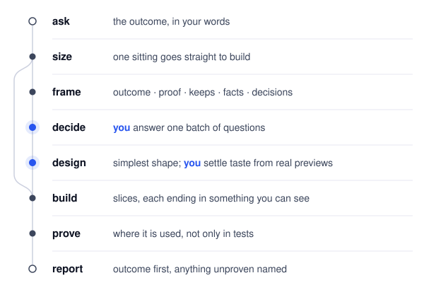

# nstack

How I build software with coding agents: a short set of standing rules, skills that load when the work calls for them, and a few slash commands for [omp](https://github.com/can1357/oh-my-pi).

Coding agents fail in predictable ways on real work. They start building before the facts and decisions that decide the result are pinned down. They build a look at full scale before anyone has seen it. They call it done because the tests pass, not because it works where it will be used. And they keep spending agents, reviews and tests long after more of it stops changing the outcome. nstack moves the effort to the start and the proof to the place the work gets used.

It is written for one person, me (Nate), and tuned against an audit of about a thousand of my own agent sessions. The rules name me, my Mac and my phone on purpose: an agent does better with a specific person and a specific setup than with "the user". It is published as a reference. Fork it and make it yours.

## The ideas

Every rule follows from four ideas, and the skills tell agents to reason from them wherever no rule fits:

- **Proportion.** The person's attention, wall time and usage are all costs. Spend where it changes what they get, in proportion to how likely it is to change it. Agent time is cheap next to theirs, so agents do the translating: what the person reads or decides from is built for them, not agents' working text passed through.
- **Reality settles facts.** Facts, causes and numbers get checked, not assumed; an agent's report is a claim until an artifact shows it. Taste, scope and one-way doors belong to the person, decided from real previews.
- **Simple architecture matters most.** Machinery nobody needs makes every later change cost more, and a simple shape can always be extended when a real need shows up.
- **A worker knows only its brief.** Delegation carries intent exactly as far as the brief does.

## How a task runs

<picture>
  <source media="(prefers-color-scheme: dark)" srcset="https://raw.githubusercontent.com/nategriffin26/nstack/master/docs/task-flow-dark.svg">
  <source media="(prefers-color-scheme: light)" srcset="https://raw.githubusercontent.com/nategriffin26/nstack/master/docs/task-flow-light.svg">
  
</picture>

Each question comes with a recommended default, and work that doesn't depend on the answer keeps moving while you think; `/nstack grill` trades the single batch for rounds when you want them. The frame's facts are checked with a command, never assumed. Done means it works where you'll use it: your phone, the app after a restart, the real CLI, real data.

## What's in it

| Piece | Loads | What it does |
|---|---|---|
| `omp-rules.md` | every session and subagent, always | The floor: thirteen standing rules in under 4,000 characters |
| `skills/nstack` | before features, multi-step changes and agent briefs | The process: size, frame, decide, build, run agents, prove, report |
| `skills/nstack-design` | big asks: rewrites, new systems, unsettled architecture or look | A one-page shape: requirements by source, verified facts, decisions, the simplest architecture, slices with checks |
| `skills/nstack-verify` | when proof needs more than the tests, a number decides something, or speed is the goal | Proof on the real surface; checks a number before it counts; a speed loop on one number, one change per step, each kept or reverted |
| `skills/nstack-review` | reviews and critic verdicts | Two lenses, by a model of another family: what would hurt on the real setup, each finding judged by its likelihood there and proven where it can be, and what to cut, tighten or redesign, said boldly as advice; abstract bug hunting is left to tests and verification |
| `skills/nstack-writing` | before writing prose anyone reads beyond a few lines | Thirty habits that make agent prose read as generated, each with its plain replacement, and one edit pass for long drafts |
| `skills/nstack-grill` | only when asked | Rounds of questions to get on the same page before work starts |
| `skills/nstack-research` | whenever outside facts are needed | Sizes the work as a Look up, a Dig (one agent, a short cited note), a Wave (research lanes, verification, a synthesis) or a Trail (one agent walking out from seeds into a space you don't know, a reading map), checks earlier research first and saves what it finds |
| `skills/nstack-research-worker` | autoloaded into the `researcher` and `verifier` agents | Their field guide: how to search and read, the note, dossier, map and verification formats, confidence rules |
| `tools/web.py` | on PATH as `web` | Search (Exa, falling back to TinyFish), read (TinyFish, then Exa, then Wayback), GitHub and Reddit readers, a page store and a log that `web check` holds every citation to; `web mcp` serves search and read over MCP, and `tools/executor-web` is that server as an Executor app |
| `skills/nstack-skills` | before an agent writes, updates, merges or retires a skill in any store | When a skill is worth writing, a description that routes (short first sentence, contrast with the nearest skill), the body's bar, and the routing check before saving |
| `tools/skill_eval.py` | on PATH as `skill-eval` | Routing check: shows each store's skill list as its router sees it (omp's compressed hints, Dross's catalog, the brain's instructions, Claude Code's list) and scores real past requests against it, current list beside a proposed change; cases live privately in `local/evals/skill-routing/cases.jsonl` |
| `skills/schematic-figure`, `skills/patent-drawing` | drawing a paper, talk or proposal schematic, concept or setup figure, block diagram or patent sheet | [LGW Lab's](https://github.com/lgwrightlab/schematic-figure) vendored skills (MIT, see `skills/schematic-figure/UPSTREAM.md`): vector SVG/PDF/PNG drawn from code in headless Chrome, optional Blender 3D |
| `skills/nstack-formal` | only when asked | Formal verification of the promise where a bug costs most, with a model checker, a verifier or deterministic simulation of the real code, left behind as a check that reruns with one command |
| `commands/` | when typed | The slash commands below |
| `extensions/nstack-guard.ts` | always, as an omp extension | One-line notes at the moments the written rules did not hold: writing to a critic that already gave its verdict, a question while agents run, a ledger past 12 KB, a new comment, docstring or README line about earlier code or the conversation ("used to", "before this fix", "as requested"), and a pointer back to the ledger after compaction |
| `extensions/brief.ts`, `extensions/brief.md` | when typed, as `/brief` | A briefing agent reads the request and the code, docs and history it touches, then sends the brief it writes as your prompt in the same session |
| `tools/brief_eval.py` | by hand | Measures `/brief`: replays real past requests in sandboxed clones of the repo at the time, briefed and direct, and has a model from another family judge each first reply against a hindsight rubric; tasks and results stay private in `local/evals/brief/` |
| `roster.toml`, `agents/` | at install | Which model does which job; generates omp's agent files and a routing section in `~/.omp/agent/AGENTS.md` |
| `audit/scripts/` | by hand | The session metrics the rules were tuned against; they read omp's local session store |

## Commands

| Command | Does |
|---|---|
| `/nstack <task>` | Runs the task with the full process. Useful when a session treats a real feature as a quick fix |
| `/nstack shape <ask>` | Requirements, architecture and what forces each part, slices with checks, and one batch of questions. Builds nothing |
| `/nstack grill [topic]` | Rounds of numbered questions on the important things only, each with a recommended answer ("yes" takes it), facts looked up rather than asked, then the frame back for your yes. "grill me" works too |
| `/nstack review` | One deep review of the current change by a model of another family: what would hurt on the real setup, each finding with its proof, and what to simplify, tighten or redesign |
| `/nstack verify` | Proves the current work on the real surface and checks any measured number |
| `/nstack formal [area]` | Formally verifies the riskiest promise in the repo (or the named area) with a model checker, a verifier or deterministic simulation; `formal maintain` brings an existing check back in line after the code moved |
| `/nstack correct <mistake>` | For a mistake that keeps coming back: finds its past instances and fixes it in structure (architecture, a type, a check whose error names the fix), proven against a real past instance |
| `/nstack simplify [area]` | Makes an area smaller without changing what it does: merges modules that do too little, removes duplicate definitions, dead code and leftover workarounds, one commit each, and records the files touched per commit for the next pass to compare |
| `/catchup` | Catches you up: what needs you, what changed, what is still running. `/catchup how/why <thing>` explains how or why something works, grounded in the code and its history; `/catchup <what's unclear>` re-explains the last reply plainly |
| `/brief <request>` | A briefing agent investigates first and writes the prompt: your words quoted, the facts and recorded decisions that bear on them, the questions only you can answer, and what done looks like. The brief is then sent in this session, and the agent works from it. The status line shows the briefer's steps |
| `/improve <prompt>` | Before running a prompt: weighs what the result is worth, names who you would hire for it, the one move the prompt leaves out, the rawest source and one outside check that could prove it wrong, then rewrites the prompt with that check as evidence to report, a budget and a point to stop |

## Asking well

- Give the outcome in your own words, where you will check it, what must not change, and references for anything visual (or "show me directions").
- For a long run, give a finish condition that can pass or fail. A duration is not one.
- For a bug, describe what you see rather than your theory of the cause, so the agent looks everywhere first.
- Races between models and extra critics run only when you ask for them by name ("race opus and astra on this").
- Anything you say explicitly overrides nstack: models, number of agents, skipping a preview.
- Long work keeps one ledger at `local/nstack/<slug>.md` in the project; "continue <thing>" or `/catchup` resumes from it.

## Install

Needs omp and Python 3.11 or newer. Used on macOS.

```sh
gh repo clone nategriffin26/nstack ~/Projects/nstack
cd ~/Projects/nstack
python3 install.py              # back up, install, then run --check
python3 install.py --check      # verify links, generated files, rule blocks, sizes and roster models
python3 install.py --uninstall  # remove nstack and restore what the first install replaced
```

The installer symlinks the skills, commands and extensions into `~/.omp/agent/` `tools/web.py` to `~/.local/bin/web` and `tools/skill_eval.py` to `~/.local/bin/skill-eval`, generates one agent file per roster agent, and writes marked blocks into `~/.omp/agent/RULES.md` and `~/.omp/agent/AGENTS.md`. The first install backs up everything it touches to `local/backups/baseline/`, and `--uninstall` restores from there; every later install writes a dated backup too. Edit files in the repository, never the installed copies, and rerun the installer.

`web` reads its keys from the environment or `~/.omp/agent/keys.env`: `EXA_API_KEY` for search, `TINYFISH_API_KEYS` (comma-separated free keys) for reading and as the search fallback, optionally `BRAVE_API_KEY` and `SERPER_API_KEY`, and `OPENROUTER_API_KEY` for the support score `web check` gives each claim (Jev, about $0.04 per million input tokens; without the key check skips it and says so). `web save` and `web prior` keep research in [nbrain](https://github.com/nategriffin26/nbrain) when its CLI is on PATH.

`--check` validates every roster model against your `omp models` catalog, so on a different setup edit `roster.toml` before the first install.

## Make it yours

1. **Fork and clone** it anywhere; the installer links from wherever the repository sits. My path (`~/Projects/nstack`) and my model settings page appear only in the routing text `install.py` generates.
2. **Put your name in.** `git grep -n Nate` finds every mention: the rules, skills, commands, agent templates, the guard's notes and that generated routing text. Swap my phone, Mac and data for the places you check your own work.
3. **Pick your models.** `roster.toml` maps roles (author, systems, taste, implementer, reader, research, verify) to agents and agents to models from `omp models`; `family` decides which models review each other. The research and verify roles are the workers of `skills/nstack-research`.
4. **Install and probe.** Run a fresh omp session on an ordinary-looking task in a scratch repo, and judge it by what the agent actually read, ran and changed, not by what it says it followed.

Keep `omp-rules.md` under 4,000 characters and each skill under 20,000. The rules ride on every turn of every session, so the floor stays short and the detail loads on demand; `--check` enforces both limits.

## Credits

- [pstack](https://github.com/cursor/plugins/tree/main/pstack) by Lauren Tan (MIT): the multi-agent control in `skills/nstack` §4 (from orchestrate, swarm and interrogate), the measurement checks (benchmark-checklist, explain-the-number, hillclimb), the verify script (create-verification-skill), the debugging rules (bug-fix, attack-the-premise, fix-root-causes), `/nstack correct` and `skills/nstack-formal` (create- and maintain-formal-verification-skill, pstack 0.15.29).
- [Specula](https://github.com/specula-org/Specula) (Apache-2.0): `nstack-formal`'s history-mined targets and trace validation (bug-archaeology, tla-trace-workflow).
- [mattpocock/skills](https://github.com/mattpocock/skills) (MIT): the grilling skill behind `nstack-grill`, limited to the important things and run only on request; the deletion test and the targets read from git history in `/nstack simplify` (improve-codebase-architecture).
- [helix](https://github.com/DocumentDrivenDX/helix): the no-process-porn skill.
- [Planning with Agents](https://maggieappleton.com/planning-agents) by Maggie Appleton: agents doing the translating (Proportion), the design shape kept for builders while Nate reads a version built for him (her boundary objects), options shown by what they do to the real code, live controls for a continuous taste value, and short grill rounds with "show me".
- [U.S. Graphics Company](https://x.com/usgraphics/status/2114413710395720182): the floor's line on language and names, from their naming rule ("the word a 1972 IBM engineer would write in a specification") and their observation that a professional register brings better-structured code. A critique in the replies kept the specification register and traded the persona for its rules: the domain's own term, one term per concept, no vague names.
- [0xdef1](https://x.com/0xdef1/status/2114384292780589327): the ledger kept to its current state with history in an archive file, and the guard's note when it grows past 12 KB (markdown considered harmful); rules recorded in the narrowest file that loads where they apply (no global state in boot docs); repeated commands turned into a small tool (build tools, not rules).
- [How I work with Agents](https://x.com/thorstenball/status/2114386050638336082) by Thorsten Ball: checking every plausible cause in one pass instead of trying fixes one at a time (`skills/nstack` §2), and the agent session behind a change as a source for `/catchup why`.
- [codetesla51/skills](https://github.com/codetesla51/skills): the attack-first test rules in `skills/nstack` §5 and the review's check-the-checks step (go-test-hardening), fakes at the wire and outcome assertions (its mocking reference), starting a fix from the last version that worked and fixing the same mistake elsewhere (debugging), fewer concepts and no silent defaults (go-codebase-cleanup), reverting speed changes inside the noise (perf-optimizer, barrage) and the rejected option in the commit message (code-ownership). That repository has no license, so these are paraphrased ideas; no text was copied.
- [Traits](https://traits.sh/) by Harry Solovay: the review's pass over Nate's recorded picks, testing the diff against each one in turn, from its `check_traits` tool.
- [system-design-skills](https://github.com/proyecto26/system-design-skills) by J.D. Nicholls (MIT): the signal that would call for the next step up, named beside the plain architecture in `nstack-design` (its "change it when" column, a number or observable signal, never "if needed").
- [How I Design with AI, part 2](https://x.com/reactiverobot/status/2115075879923765615) by Matt Dailey: crux screens that get the taste work in a many-screen feature, and the craft pass's sheet of every state grouped by screen, listed from the code first, with the bugs found on the way (his [ui-sweep](https://github.com/ref-tools/marketplace/tree/main/plugins/ref-skills/skills/ui-sweep) skill, MIT).
- [ub-mode](https://github.com/unclebob/ub-mode) by Robert C. Martin: setting a bolt-on beside the design that would have been built had the requirement been there from the start (`skills/nstack` §2 Design, its Redesign From First Principles). That repository has no license, so the idea is paraphrased; no text was copied.
- [Babysitting AI Agents](https://arxiv.org/abs/2610.34748) by Mittal, Kim, Counts, Neville, Das and Laban (Microsoft Research, Georgia Tech): stopping a unit or loop that has stopped producing new evidence (`skills/nstack` §4), from its finding that running without progress is among the most reported delegation failures, and the report's list of actions the diff will not show (§6), from its finding that the most severe failures are the hardest to notice.
- [Alpha generation p1: self-editing heartbeats with seeds](https://docs.google.com/document/d/14qXSLPBZENOTmYJMJPQ7xFRtMzm00qCF9foTKqque70/edit) by snbafana: the Trail in `skills/nstack-research`, one agent walking out from seeds that show what good looks like, one lead per step, re-ranking its scratchpad and keeping only what is dense and new.
- [schematic-figure](https://github.com/lgwrightlab/schematic-figure) by LGW Lab (MIT): `skills/schematic-figure` and `skills/patent-drawing`, vendored unchanged except one setup note, at commit 09d8b6e.
- [scholarly-paper-revision](https://x.com/__paleologo/status/2116602494428299632) by Giuseppe Paleologo (Gappy): `skills/nstack-writing`, from its section "Correct and avoid AI stylistic tropes", generalized from mathematical papers to reports, notes, docs, commit messages and product copy, with patterns from my agents' own reports added.
- [AI loops](https://x.com/meln1k/status/2116961861845287349) by Nikita M. (@meln1k): a loop for each of correctness, speed and structure, as deterministic simulation in `nstack-formal` with replayable seeds in `skills/nstack` §5, the speed loop in `nstack-verify`, and `/nstack simplify`, run on command rather than on a schedule.
- [deslop](https://github.com/cursor/plugins/tree/main/cursor-team-kit/skills/deslop) from Cursor's team kit (MIT): the leftovers `/nstack simplify` removes (defensive checks on trusted paths, type escapes, comments that narrate the code).
- [nando-skill](https://github.com/nandorojo/nando-skill) by Fernando Rojo: the call site written before the implementation, one operation per behavior instead of a mode argument, configuration read once into a typed value and one definition per schema or type (`skills/nstack` §2 Design and `nstack-design`); states checked exhaustively by the compiler (§5 Finish); a screen that holds still through loading, refresh and errors, with every permanent control earning its space (§5 Craft pass). The rest is specific to its TypeScript, React and Effect stack and stays out. That repository has no license, so these are paraphrased ideas; no text was copied.
- [Panta's reviewer prompt](https://x.com/thepanta82/status/2117542858907337121) (@thepanta82): the simplify questions in `skills/nstack-review` (rare edge cases to ignore, hardening nobody asked for, strict types, avoidable costs, workarounds a redesign would remove), its "be bold" and its default of uncommitted changes, and keeping abstract bug and edge-case hunting out of the review.
- [Lauren Tan on adversarial reviews](https://x.com/poteto/status/2117437607940681849): no bug hunting in the abstract, so a review's harm findings need a path to the real setup, and the rehearsal on a disposable copy beside the one-way-door critic (`skills/nstack` §4), from her finding that abstract code review gets lost in nitpicks.
- [Dave Kiss](https://x.com/davekiss/status/2118094079879794894) and [astral-sh/uv's AGENTS.md](https://github.com/astral-sh/uv/blob/main/AGENTS.md): comments and maintainer docs written for a reader who never saw the conversation, and compatibility explained as its constraint rather than "preserve the existing behavior" (`skills/nstack` §5 Word pass, `nstack-writing`'s lines on docs and commit messages), from uv's rule; the guard's note on wording about earlier code, from Dave's PreToolUse hook, as a note rather than a block and limited to the phrasings that were mostly history in about 119,000 comments my agents committed.

## License

[MIT](LICENSE)
