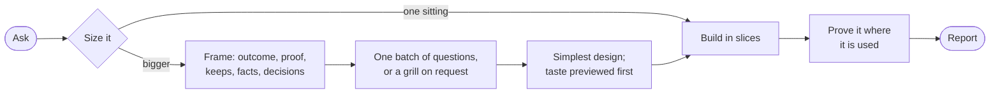

# nstack

How I build software with coding agents: a short set of standing rules, skills that load when the work calls for them, and a few slash commands for [omp](https://github.com/can1357/oh-my-pi).

Coding agents fail in predictable ways on real work. They start building before the facts and decisions that decide the result are pinned down. They build a look at full scale before anyone has seen it. They call it done because the tests pass, not because it works where it will be used. And they keep spending agents, reviews and tests long after more of it stops changing the outcome. nstack moves the effort to the start and the proof to the place the work gets used.

It is written for one person, me (Nate), and tuned against an audit of about a thousand of my own agent sessions. The rules name me, my Mac and my phone on purpose: an agent does better with a specific person and a specific setup than with "the user". It is published as a reference. Fork it and make it yours.

## The ideas

Every rule follows from four ideas, and the skills tell agents to reason from them wherever no rule fits:

- **Proportion.** The person's attention, wall time and usage are all costs. Spend where it changes what they get, in proportion to how likely it is to change it.
- **Reality settles facts.** Facts, causes and numbers get checked, not assumed; an agent's report is a claim until an artifact shows it. Taste, scope and one-way doors belong to the person, decided from real previews.
- **Simple architecture matters most.** Machinery nobody needs makes every later change cost more, and a simple shape can always be extended when a real need shows up.
- **A worker knows only its brief.** Delegation carries intent exactly as far as the brief does.

## How a task runs



Small asks get done, proven and reported. Anything bigger gets a short frame first: the outcome in the person's words beside the agent's reading, where it will be checked, what must not change, the load-bearing facts (each checked with a command) and the open decisions. The agent asks once, with a recommended default for each question, and keeps working on everything that does not depend on the answer. New taste gets several real directions before anything is built at scale. Work lands in slices that each end in something visible, and done means it works on the real surface: the phone, the app after a restart, the real CLI, real data.

## What's in it

| Piece | Loads | What it does |
|---|---|---|
| `omp-rules.md` | every session and subagent, always | The floor: ten standing rules in under 2,000 characters |
| `skills/nstack` | before features, multi-step changes and agent briefs | The process: size, frame, decide, build, run agents, prove, report |
| `skills/nstack-design` | big asks: rewrites, new systems, unsettled architecture or look | A one-page shape: requirements by source, verified facts, decisions, the simplest architecture, slices with checks |
| `skills/nstack-verify` | when proof needs more than the tests, or a number decides something | Proof on the real surface; checks a number before it counts |
| `skills/nstack-review` | reviews and critic verdicts | Findings judged by how likely and how harmful they are on the real setup |
| `skills/nstack-grill` | only when asked | Rounds of questions to get on the same page before work starts |
| `skills/nstack-formal` | only when asked | Formal verification of the promise where a bug costs most, left behind as a check that reruns with one command |
| `commands/` | when typed | The slash commands below |
| `extensions/nstack-guard.ts` | always, as an omp extension | One-line notes at the moments the written rules did not hold: writing to a critic that already gave its verdict, a long brief to an agent that already exists, a subagent past 250K tokens of context, a question while agents run, and a pointer back to the ledger after compaction |
| `roster.toml`, `agents/` | at install | Which model does which job; generates omp's agent files and a routing section in `~/.omp/agent/AGENTS.md` |
| `audit/scripts/` | by hand | The session metrics the rules were tuned against; they read omp's local session store |

`dross.md` is an intake block for my personal assistant; the installer skips it when the assistant isn't there.

## Commands

| Command | Does |
|---|---|
| `/nstack <task>` | Runs the task with the full process. Useful when a session treats a real feature as a quick fix |
| `/nstack shape <ask>` | Requirements, architecture and what forces each part, slices with checks, and one batch of questions. Builds nothing |
| `/nstack grill [topic]` | Rounds of numbered questions on the important things only, each with a recommended answer ("yes" takes it), facts looked up rather than asked, then the frame back for your yes. "grill me" works too |
| `/nstack review` | One review of the current change against the ask, each finding with a failing case |
| `/nstack verify` | Proves the current work on the real surface and checks any measured number |
| `/nstack formal [area]` | Formally verifies the riskiest promise in the repo (or the named area) with a model checker or verifier; `formal maintain` brings an existing check back in line after the code moved |
| `/nstack correct <mistake>` | For a mistake that keeps coming back: finds its past instances and fixes it in structure (architecture, a type, a check whose error names the fix), proven against a real past instance |
| `/bro` | Re-explains the last reply plainly. `/bro catch me up` catches up; `/bro how/why <thing>` explains how or why something works, grounded in the code and its history |
| `/improve <prompt>` | Before running a prompt: names who would be best at the task, what they would do that the prompt does not ask for, and an outside check that could prove the result wrong, then rewrites the prompt to ask for that |

## Asking well

- Give the outcome in your own words, where you will check it, what must not change, and references for anything visual (or "show me directions").
- For a long run, give a finish condition that can pass or fail. A duration is not one.
- For a bug, describe what you see rather than your theory of the cause, so the agent looks everywhere first.
- Races between models and extra critics run only when you ask for them by name ("race opus and astra on this").
- Anything you say explicitly overrides nstack: models, number of agents, skipping a preview.
- Long work keeps one ledger at `local/nstack/<slug>.md` in the project; "continue <thing>" or `/bro catch me up` resumes from it.

## Install

Needs omp and Python 3.11 or newer. Used on macOS.

```sh
gh repo clone nategriffin26/nstack ~/Projects/nstack
cd ~/Projects/nstack
python3 install.py              # back up, install, then run --check
python3 install.py --check      # verify links, generated files, rule blocks, sizes and roster models
python3 install.py --uninstall  # remove nstack and restore what the first install replaced
```

The installer symlinks the skills, commands and extension into `~/.omp/agent/`, generates one agent file per roster agent, and writes marked blocks into `~/.omp/agent/RULES.md` and `~/.omp/agent/AGENTS.md`. The first install backs up everything it touches to `local/backups/baseline/`, and `--uninstall` restores from there; every later install writes a dated backup too. Edit files in the repository, never the installed copies, and rerun the installer.

`--check` validates every roster model against your `omp models` catalog, so on a different setup edit `roster.toml` before the first install.

## Make it yours

1. **Fork and clone** it anywhere; the installer links from wherever the repository sits. My path (`~/Projects/nstack`) and my model settings page appear only in the routing text `install.py` generates and in `dross.md`.
2. **Put your name in.** `git grep -n Nate` finds every mention: the rules, skills, commands, agent templates, the guard's notes and that generated routing text. Swap my phone, Mac and data for the places you check your own work.
3. **Pick your models.** `roster.toml` maps roles (author, systems, taste, implementer, reader, research, verify) to agents and agents to models from `omp models`; `family` decides which models review each other. The research and verify roles expect a `research` skill that is not part of this repository: bring your own or drop the roles.
4. **Install and probe.** Run a fresh omp session on an ordinary-looking task in a scratch repo, and judge it by what the agent actually read, ran and changed, not by what it says it followed.

Keep `omp-rules.md` under 2,000 characters and each skill under 12,000. The rules ride on every turn of every session, so the floor stays short and the detail loads on demand; `--check` enforces both limits.

## Credits

- [pstack](https://github.com/cursor/plugins/tree/main/pstack) by Lauren Tan (MIT): the multi-agent control in `skills/nstack` §4 (from orchestrate, swarm and interrogate), the measurement checks (benchmark-checklist, explain-the-number, hillclimb), the verify script (create-verification-skill), the debugging rules (bug-fix, attack-the-premise, fix-root-causes), the safety-fact review step (blast-radius), `/nstack correct` and `skills/nstack-formal` (create- and maintain-formal-verification-skill, pstack 0.15.29).
- [Specula](https://github.com/specula-org/Specula) (Apache-2.0): `nstack-formal`'s history-mined targets and trace validation (bug-archaeology, tla-trace-workflow).
- [mattpocock/skills](https://github.com/mattpocock/skills) (MIT): the grilling skill behind `nstack-grill`, limited to the important things and run only on request.
- [helix](https://github.com/DocumentDrivenDX/helix): the no-process-porn skill.
- [codetesla51/skills](https://github.com/codetesla51/skills): the attack-first test rules in `skills/nstack` §5 and the review's check-the-checks step (go-test-hardening), fakes at the wire and outcome assertions (its mocking reference), starting a fix from the last version that worked and fixing the same mistake elsewhere (debugging), fewer concepts and no silent defaults (go-codebase-cleanup), reverting speed changes inside the noise (perf-optimizer, barrage) and the rejected option in the commit message (code-ownership). That repository has no license, so these are paraphrased ideas; no text was copied.

## License

[MIT](LICENSE)
